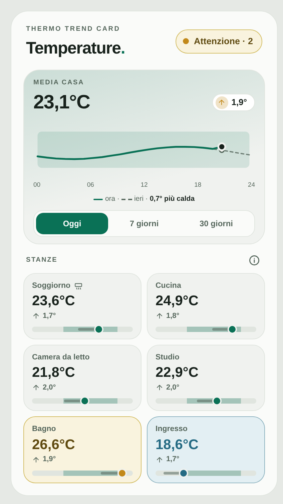
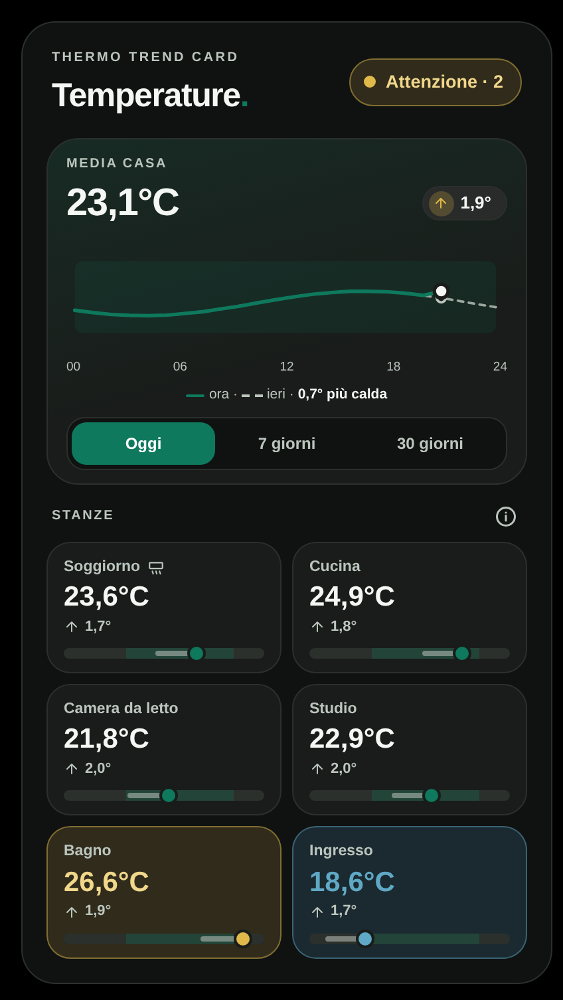
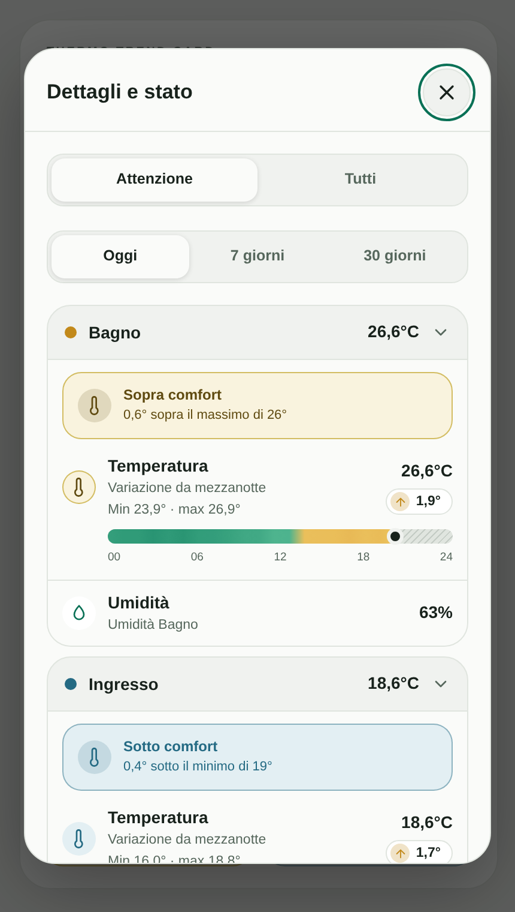
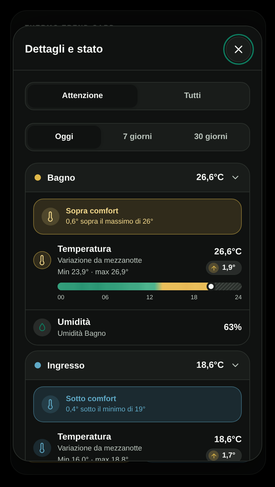
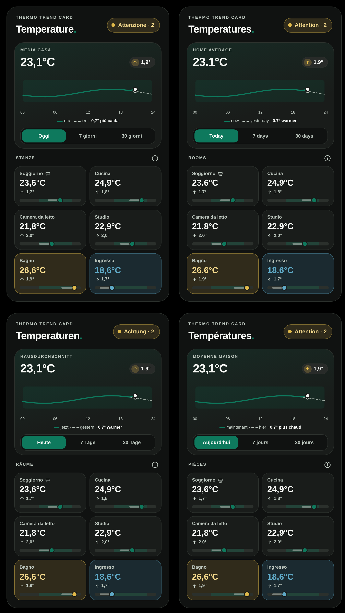

# Thermo Trend Card

## Overview

**Thermo Trend Card** is a custom temperature card for Home Assistant, designed with a minimalist, responsive interface inspired by the Edera Light and Dark visual styles.

The top panel shows the average temperature of the home with its change, and a chart of how it evolved today, over 7 days or over 30 days, drawn over a comfort band. An optional dashed line compares it with the previous period. Below, one tile for each room shows the current temperature, its change, and a bar that places the reading and the period's minimum and maximum against the comfort range: amber above it, blue below it. The details popup lists every room with its sensors and tells you at a glance which ones are out of the comfort range.

The card is modular. Temperatures, humidity and an air conditioner temperature sensor are separate modules. Rooms are the areas you already have in Home Assistant, and the humidity and air conditioner sensors are matched to the room they belong to.

The interface is available in Italian, English, German and French. It follows the language of your Home Assistant profile, falls back to English for any other language, and the language can also be chosen in the editor.

The card reads `sensor` entities and shows the values as reported by your sensors, so it is not tied to a specific device manufacturer, and it does not require a dedicated account, paid API, or subscription.

## Preview

  
  

  
  

  

*Thermo Trend Card in Edera Light and Dark modes, with its details popup, and in its four languages (Italian, English, German and French). The previews use demonstration values and do not display private installation data.*

## Features

- **Home average:** The average temperature of the rooms, with its change over the selected period.
- **Trend chart:** The average temperature over today, 7 days or 30 days, over the comfort band. Slide a finger or the pointer over the chart to read the value and the time of each point.
- **Comparison with the previous period:** An optional dashed line shows yesterday, the 7 days before or the 30 days before, with the difference from now. It can be turned off in the editor, and the card hides it by itself when the data is missing.
- **Room tiles:** Temperature, change over the period, and a bar with the comfort range, the minimum and maximum of the period and the current reading. Tiles turn amber above the comfort range and blue below it. A small icon shows that the room has an air conditioner sensor.
- **Unit of measurement:** Current values show the unit reported by each sensor (for example °C or °F). Changes are shown with the degree sign only.
- **Comfort range:** Minimum and maximum chosen in the editor, in the unit of your sensors.
- **Attention label:** The label next to the title counts the rooms out of the comfort range, or reads *In comfort* when there are none. Tap it, or any tile, to open the details popup.
- **Details popup:** Fixed-height popup, centred on the screen, with filters for the rooms that need attention (shown first) and for all rooms, and the period selector. Each room opens to a status box, the temperature with a coloured ribbon of the period, the humidity and the air conditioner sensor. On tablets and desktop it uses a wide layout with columns.
- **Modules:** Temperatures, Humidity and Air conditioner, each with its own entities, in the order you choose.
- **Rooms from Home Assistant:** Sensors are grouped by the area of the entity or of its device. A sensor without an area is shown as a room of its own.
- **Edera appearance:** Automatic, Light, and Dark themes, a compact layout limited to a narrow width on tablets and desktop (or the full available width, if you prefer), rounded elements, and native Home Assistant icons.
- **Visual configuration:** Choose entities with the native Home Assistant selectors in the dashboard editor, or add the temperature and humidity sensors of a whole room at once.

Unavailable or unknown sensors are always reported as not available and never counted as in the comfort range.

## Installation

### Marketplace — Custom repository

Thermo Trend Card can be added to the Home Assistant Marketplace from its GitHub repository.

1. Go to **Settings** > **Marketplace**.
2. The first time, accept the notice about community content and connect your GitHub account when asked.
3. Choose **Add from link** and paste `https://github.com/luigi-regolo/thermo-trend-card`.
4. If asked, choose the **Dashboard** type.
5. Open **Thermo Trend Card** and select **Install**.
6. Reload your browser to load the new resource.
7. Add **Thermo Trend Card** to your dashboard and configure it using the visual editor.

### Manual installation

1. Download `dist/thermo-trend-card.js` from this repository.
2. Copy the JavaScript file to the `www` directory of your Home Assistant configuration.
3. In Home Assistant, open **Settings → Dashboards → Resources**.
4. Add `/local/thermo-trend-card.js` as a **JavaScript module**.
5. Reload the dashboard and add the custom card.

If the `www` directory was newly created, Home Assistant may require a restart before the file is accessible.

## Configuration and Usage

### Visual editor

Open a dashboard in edit mode, add **Thermo Trend Card**, and configure the available sections:

- **Home:** The home summary, the trend chart, the comparison with the previous period, the legend and the comfort range.
- **Modules:** For each module, whether it is active, its entities and its position. For temperatures and humidity, **Add from room** adds the compatible sensors of a room in one step; it lists only rooms that have compatible sensors not yet added.
- **Appearance:** Header, title, theme, language and a switch for the full available width on tablets and desktop (off by default: narrow and centred).

The editor uses native Home Assistant entity selectors. The temperature and humidity modules list sensors with the matching device class; the air conditioner module accepts any `sensor`, so choose the one that reports the temperature.

### Rooms

Rooms are read from the area assigned to each entity or to its device in Home Assistant. Humidity and air conditioner sensors join the room that has the same area as the temperature sensors.

### Periods and comparison

The period selector in the top panel and in the popup switches between today, 7 days and 30 days. Today is built from the recorded history of the sensors; 7 and 30 days use the long-term statistics. The comparison line uses the same sources for the period just before.

## Compatibility and Requirements

Thermo Trend Card requires:

- Home Assistant with support for custom JavaScript dashboard cards.
- One or more `sensor` entities with a numeric temperature. To be offered in the temperature and humidity selectors, they need the `temperature` and `humidity` device class.
- The history of the sensors (the Home Assistant recorder) for the chart and the changes. Without it, the card shows the current values only.
- Long-term statistics of the sensors for the 7 and 30 day periods and for the comparison. Sensors that report a measurement value normally have them.

The card shows temperatures with the unit reported by the sensors, without converting units, and the comfort range is expressed in the unit of your sensors. Mixing Celsius and Fahrenheit sensors in the same card is not recommended.

The card interface is available in Italian, English, German and French. Names of entities, rooms and devices come from Home Assistant and are not translated.

No specific minimum Home Assistant version has been independently verified for this repository.

The card does not require a dedicated paid service or additional remote JavaScript libraries.

## Releases

See the [GitHub Releases](https://github.com/luigi-regolo/thermo-trend-card/releases) page for the published versions.

## Privacy and Security

Thermo Trend Card only reads Home Assistant entities and their history, with the permissions of the authenticated user, and it never sends commands.

- The card does not include advertising, analytics, telemetry, or user-tracking services.
- It does not contact any server other than your Home Assistant instance.

The card is informational: what it shows reflects the values reported by your sensors, and unknown, unavailable, or missing information must not be read as a normal temperature.

## Copyright & License

Copyright © 2026 luigi-regolo.

Original project created and maintained by **luigi-regolo**.

Licensed under the **GNU General Public License version 3 only (GPL-3.0-only)**.

See the [LICENSE](LICENSE) file for the complete license terms.

The software is provided without warranty to the extent permitted by applicable law.
